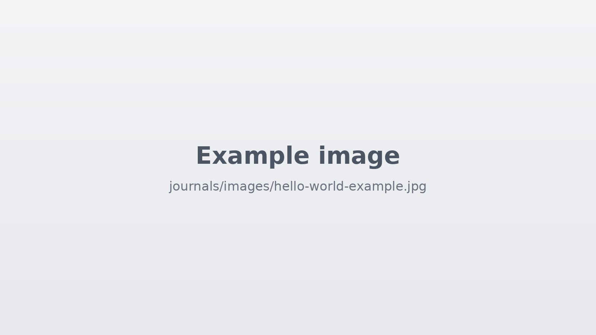

Hello world!

This entry is the Markdown file `journals/hello-world.md`, turned into a page in the browser.

## An embedded image



Images live in `journals/images/`. Paths are written relative to this file, so the line above is:

```

```

## Formatting check

Text can be **bold**, *italic*, or `inline code`, and [links work](../index.html).

- A bullet list
- with two items

> A quote looks like this.
